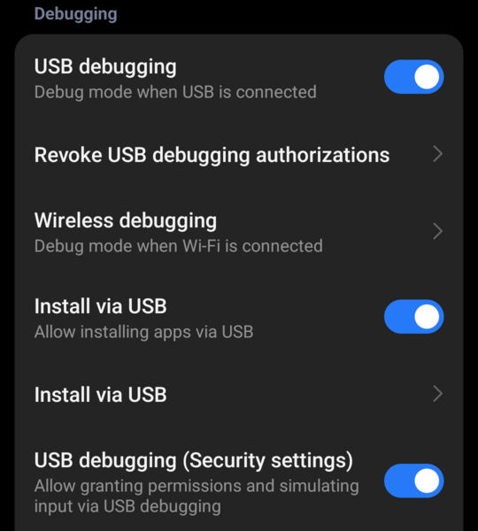

# Developer Notes

- Uses MicroPython `ports/embed`, not `ports/unix`.
- Two processes: user interface and MicroPython interpreter.
- interface between user interface and MicroPython interpreter is [AIDL](https://developer.android.com/develop/background-work/services/aidl).
- interface between MicroPython interpreter and Android is [JNI](https://developer.android.com/ndk/guides/jni-tips).
- The MicroPython file system is in the app's private storage.
- upstream repositories are pinned to version or commit hash.
- `arm64-v8a` only. An arm32 build is possible but out of scope: the release test matrix would double.

## Build

### Local build

Requirements:

- A full JDK 21, with `javac`.
- See [`tools/docker/Dockerfile`](../tools/docker/Dockerfile) for Android SDK, NDK, CMake and platform versions. 
- Put SDK path in `upy-android/local.properties`, for example `sdk.dir=/home/user/Android/Sdk`.

```bash
export JAVA_HOME=/path/to/jdk-21
cd upy-android
./gradlew :app:assembleDebug
# -> app/build/outputs/apk/debug/app-debug.apk
```

On a slow or filtered network, set a proxy or a mirror for Git and Gradle. See `native-bringup/fetch-upstream.sh`.

### Docker build

Run from the repo root:

```bash
docker build --target tools -t upy-android-tools -f tools/docker/Dockerfile .   # SDK/NDK install
docker build --target build --build-arg BUILD_TYPE=debug -t upy-android -f tools/docker/Dockerfile .
id=$(docker create upy-android)
docker cp "$id":/output ~/upy-android_apk
docker rm "$id"
```

The Docker build also downloads the base image from Docker Hub.

### New libraries

Gradle dependency locking is on (`upy-android/app/gradle.lockfile`). After adding a library to `build.gradle.kts`, update the lock file for all build types:

```bash
./gradlew :app:dependencies --update-locks <group>:<artifact>
```

## Install on the phone

Enable **Stay awake**, **USB debugging** on the phone.

```bash
cd upy-android/app/build/outputs/apk/debug/
adb install -r app-debug.apk
```

### Xiaomi: installing over USB

Tested on a REDMI Note 15 5G. In **Developer options**, enable **USB debugging**, **USB debugging (Security settings)** and **Install via USB**. Below the **Install via USB** switch is a second item with the same name, **Install via USB >**. Tap this second item. The screen shows "Denied installation of the following apps via USB". If upy-android is in this list, set its switch to off. Otherwise `adb install` of upy-android is refused.



## Testing

### adb exec

adb exec runs MicroPython scripts on the phone from a PC. adb exec is a content provider in the app; programmers and AI agents use adb exec for development and testing.

adb exec is remote code execution by design. Anyone with ADB access to the device can run arbitrary MicroPython. Leave adb exec off unless developing.

To enable adb exec:
- **USB debugging.** Needed for adb. Open **Settings > About phone** and tap **Build number** 7 times. Then enable **USB debugging** in **Developer options**.
 in upy-android, open **Settings** and enable **adb exec**. Then start with:

```bash
adb exec-out content call --uri content://eu.kdvelectronics.upyandroid.exec --method help
```

Run a script from the PC:

```bash
tools/upy-adb script.py
```

`tools/upy-adb` resets the interpreter, runs the file on the phone and prints the output. Without the tool, the script goes base64-encoded in the `run` call:

```bash
adb exec-out content call --uri content://eu.kdvelectronics.upyandroid.exec --method run --arg "$(base64 -w0 script.py)"
```

To stop a running script, for example one with `while True`, run in a second terminal:

```bash
adb exec-out content call --uri content://eu.kdvelectronics.upyandroid.exec --method interrupt
```

### AI-assisted programming

upy is designed for ai-assisted programming.

- `adb exec` is gated on in _Settings_
- the `help` method explains the agent 
    - how to execute MicroPython (`run` method)
    - how to list all modules (`help("modules")`)
    - how to obtain help for a module (e.g. `litert.help()`)
    - scripts in `/examples` show how to use the `image` module, which has no `help()`.

Together, this allows an agent to learn the API from the phone.
When adding, removing or changing a method, update the module's `help()` text in the same commit.

The modules `camera`, `display`, `android`, `imu`, `tflite`, `litert`, `umqtt`, `http` and `zipfile` have a `help()` function. For example: `import camera; print(camera.help())`.
The modules `image`, `gif`, `mjpeg` and `ulab` have no `help()`; they follow OpenMV's and ulab's own documentation.

The list is repeated in `module_help` of `app/src/main/res/raw/adb_help.yaml`, which the `help` method of `adb exec` shows. Keep both in step.

### Testbench

The `upy` app has arm64 native libraries. The arm64 libraries make running a testbench on a x86-64 impractical. Running a testbench in an android emulator on arm64 linux (raspberry) is possible, but running the testbench on a phone is easier.

The test scripts run over `adb exec` on a phone connected over USB. With more than one device connected, set `ANDROID_SERIAL`.

`tools/run-tests.py` sends each test script to the app and compares the output with the `.exp` file next to the script. Test scripts are `upy-android/tests/*.py` and `upy-android/examples/*_selftest/*.py`.

```
tools/run-tests.py                 # required and known-failure tests
tools/run-tests.py --manual        # also manual tests
tools/run-tests.py --micropython   # also MicroPython's basics tests, about 15 minutes
tools/run-tests.py --only litert   # one test
tools/run-tests.py --list          # tests and their tier
```

Exit code: 0 when all required tests pass, 1 when a required test fails, 2 for a marker error.

#### Markers

Markers are comment lines at the top of a test script. The first line that is not a comment, or a blank line, ends the markers.

```python
# test: required
# fixture: ../add_simple/add_simple.tflite /examples/add_simple.tflite
```

- `# test: required`: must pass. A failure fails the run.
- `# test: known-failure <reason>`: a known bug. The test runs and a failure is reported, but does not fail the run. If the test passes, the report says "unexpectedly passed": the bug may be fixed, and the test can become required.
- `# test: manual <reason>`: not run by default. Run with `--manual`.
- `# fixture: <local> <device>`: copies a file to the phone before the test. `<local>` is relative to the folder of the test script, `<device>` is an absolute path on the phone.
- `# runs: host`: the script runs on the PC instead of the phone, and talks to the phone through adb exec. The test passes when the script exits with code 0. A host check has no `.exp` file.
- `# needs: --micropython`: not run by default. Run with `--micropython`. The time limit is 60 minutes instead of 5.

Each test script needs one `# test:` line.

A test is named after what it tests.

#### Expected output

The `.exp` file holds the expected output. For a known failure, the `.exp` file holds the correct output, not what the script prints today.

A missing `.exp` file is an error. `--record --only <name>` writes the current output as the `.exp` file; read the file before trusting it.

#### MicroPython's own tests

- `tools/run-tests.py --micropython` also runs MicroPython's own `basics` tests (`upy-android/tests/micropython_basics.py`). Tests that fail or cannot run on the phone are in `upy-android/tests/micropython_known_failures.txt`, each with a reason.
- `tools/run-micropython-tests.sh` runs any part of MicroPython's test suite, without the list of known failures, for example `tools/run-micropython-tests.sh -d extmod`.

## Upstream code and patches

- The versions of MicroPython, OpenMV, AprilTag, ulab and LiteRT are pinned in [`upy-android/upstream.properties`](../upy-android/upstream.properties).
- `upy-android/native-bringup/vendor/` has unmodified upstream files. `upy-android/native-bringup/my-overrides/` has this project's own files and patched copies of upstream files. A patched copy has a comment "upy-android PATCH" that explains the change.
- The build generates `micropython_embed/` from these two directories. Do not edit `micropython_embed/` by hand: the next build overwrites it.

## Networking

For networking, a known good Java, Kotlin, C or C++ library is wrapped as a MicroPython module.

Three layers, for example `umqtt`:

1. MicroPython module: `mqtt_module.cpp`.
2. JNI interface: `mqtt_jni_bridge.cpp`, `mqtt/MqttShim.kt`.
3. External library: HiveMQ MQTT Client.

Protocols that have to be persistent across interpreter resets and crashes, or that need an Activity, are better run in the user interface process, with MicroPython calling them over AIDL.

## Machine learning: tflite, litert

Two independent native modules:

- `tflite`: the classic TensorFlow Lite C API.
- `litert`: standalone LiteRT. `litert` can use the CPU, GPU or NPU.

`litert.Options(accelerator=litert.Accelerator.CPU)` (or `GPU`, `NPU`) selects the accelerator.

See the `help()` of each module for the exact API.

Notes:

The APK contains LiteRT:

- LiteRT .so from github (not from Google Play).
- The GPU accelerator `libLiteRtClGlAccelerator.so` is from the `litert-gpu` AAR.
- NPU runtimes with a licence that allows redistribution are in the APK: MediaTek and Google Tensor, from the `litert-npu-runtime-mediatek` and `litert-npu-runtime-google-tensor` AARs (Apache 2.0). The AARs have the same version as LiteRT.
- The Qualcomm NPU runtime is not in the APK. The required QNN libraries come from Qualcomm's SDK, with a licence that does not allow redistribution.
- Samsung: no ready-made runtime has been found.
- If **Load accelerators from /litert/** is off at `:engine` start, NPU runtimes are loaded from `nativeLibraryDir` in the APK. `jniLibs.useLegacyPackaging = true` extracts the native libraries at install, so the plugins are real files in `nativeLibraryDir`.
- If **Load accelerators from /litert/** is on at `:engine` start and the folder `litert` is present, NPU runtimes are loaded from `files/litert`.
- `tflite` and `litert` modules take and return plain `array.array`, not `ulab.numpy` arrays.
- There is no automatic dequantization.
- Shape is a separate query, `input_shape(i)` and `output_shape(i)`. `run()` does not return shape.

## Version and release

### Version

The app version is set in one place, [`upy-android/version.properties`](../upy-android/version.properties). To change the version, edit that file and commit.

### GitHub release

To publish a release on GitHub: **Actions > upy-android > Run workflow**, tick **release**. The release tag is `v<version>` for a release build and `v<version>-debug-<run>` for a debug build.

### Signing key

If different builds of an app are signed with the same key, upgrading the app keeps the private files.
If different builds of an app are signed with different keys, the app must be uninstalled before installing the new build, losing all private files.

Debug and release APKs are signed with the release key, `~/.upy-android-release.jks` on the development PC.
The password of the key is in `~/.gradle/gradle.properties`:

```
upyStoreFile=~/.upy-android-release.jks
upyKeyAlias=upy-android
upyStorePassword=<password>
```

Keep a backup of both files offline. Without the key, the app cannot be updated or registered with Google.

GitHub builds read the key and the password from two repository secrets:

```
base64 -w0 ~/.upy-android-release.jks | gh secret set SIGNING_KEYSTORE --repo koendv/upy-android
gh secret set SIGNING_KEYSTORE_PASSWORD --repo koendv/upy-android
```

Local Docker builds need two secrets. The password is in the environment variable `UPY_STORE_PASSWORD`:

```
--secret id=signing_keystore,src=$HOME/.upy-android-release.jks --secret id=signing_password,env=UPY_STORE_PASSWORD
```

If no key is set, each Docker or GitHub build uses a different, random key.

## Distributing upy-android

upy-android is MIT-licensed. Distribution is unlimited.

Feel free to upload this app to an app store. No permission needed.
